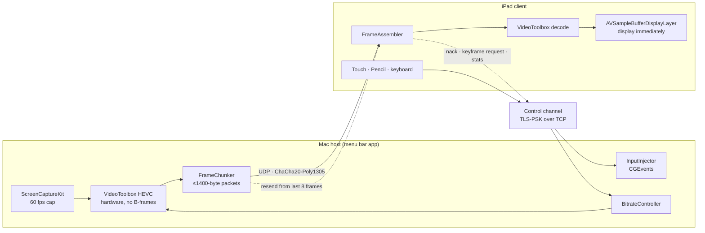

# MacStream

Low-latency screen streaming from a Mac to an iPad over local Wi-Fi, with touch, Apple Pencil and keyboard control flowing back.

[](https://github.com/samarthpaliwal/MacStream/actions/workflows/ci.yml)


<!-- TODO: add a capture of the Mac and iPad side by side. Steps are in docs/README.md.
<p align="center"></p>
-->

Native Swift and SwiftUI on both sides, with no third-party runtime dependencies.

## Problem

Remote-desktop tools treat the iPad as a slow second monitor: latency around 100 ms, gestures that do not
map to macOS, and pairing that is either insecure or painful. Using an iPad to control a Mac only feels
direct if a frame gets from capture to glass in a couple of display refreshes, survives packet loss
without stalling, and the link is encrypted without a login.

## Approach



- **Capture and encode.** ScreenCaptureKit feeds a VideoToolbox hardware HEVC session in real-time mode
  with frame reordering off and keyframes only every 10 seconds or on request.
- **Transport.** Frames are split into packets of at most 1,400 bytes and sent over UDP, each datagram
  sealed with ChaCha20-Poly1305 under a key derived from the pairing key.
- **Loss recovery, in order.** Selective retransmission first: the iPad asks for exactly the missing
  chunks and the Mac resends from the last eight frames. If a frame is still incomplete when a newer one
  completes, it is dropped and a keyframe requested. If the Mac's send queue backs up, non-keyframes are
  skipped, so a slow link adds loss and never latency.
- **Adaptive bitrate.** The iPad reports loss, drops and decode time once a second. The encoder target is
  cut 20% on unrecovered loss above 1% and stepped back up 15% after four clean seconds, applied live.
- **Input.** Touches travel in normalised coordinates and become CGEvents on the captured display, so the
  mapping is exact at any resolution. Pencil, hardware keyboard, trackpad and multi-finger gestures are mapped.
- **Pairing.** A six-digit code bootstraps a TLS pre-shared key once; after that both devices hold a
  256-bit long-term key in their Keychains and connect with one tap.
- **Measuring.** An NTP-style clock sync over the control channel lets the overlay show true
  capture-to-display latency and a per-stage breakdown without wall-clock agreement.

Details: [docs/internals.md](docs/internals.md).

## Results

Measured from a 14-inch MacBook Pro to the iPad simulator on the same machine, so network time is close to
zero and these are the pipeline's own costs. Real Wi-Fi adds the air time of each frame plus jitter.

| Preset | Size | End to end | Capture | Encode | Network | Decode |
|---|---|---|---|---|---|---|
| Balanced (75%) | 2268×1472 | **20 ms** | 3 ms | 12.7 ms | 1.5 ms | 2.8 ms |
| Performance (50%) | 1512×982 | 12 ms | 4 ms | 7.5 ms | 0 ms | 2.7 ms |

With 3% random packet loss simulated (`MACSTREAM_SIMULATE_LOSS=3`):

| | Frames dropped | Lost packets recovered | Bitrate | End to end |
|---|---|---|---|---|
| Without retransmission | 84 of 150 | none | fell to the 3 Mb/s floor | |
| With retransmission | 14 of 434 | 122 of 137 | held at 12 to 15 Mb/s | 19 ms |

Hardware HEVC encode is the largest stage and scales with pixel count, so the quality preset is the main
latency knob. The shared `StreamCore` package has 17 unit tests, run in CI.

## Quick start

Requires macOS 14 or newer, iPadOS 17 or newer, Xcode 16 or newer, and both devices on the same Wi-Fi.
A free Apple ID is enough; see [docs/setup.md](docs/setup.md) for signing, Developer Mode and permissions.

```bash
git clone https://github.com/samarthpaliwal/MacStream.git
cd MacStream
open MacStream.xcworkspace
```

1. Set `DEVELOPMENT_TEAM` in `project.yml` to your team ID and run `xcodegen generate`
   (`brew install xcodegen`), or pick your team under Signing & Capabilities for both targets.
2. Run the **MacHost** scheme on "My Mac". It appears in the menu bar and asks for Screen Recording and
   Accessibility.
3. Run the **PadClient** scheme on your iPad or an iPad simulator.
4. On the Mac choose *Pair a new iPad…*, tap the Mac on the iPad and enter the six-digit code. After the
   first time, one tap connects.

Shared package tests:

```bash
cd Packages/StreamCore && swift test
```

## Tech stack

Swift, SwiftUI, ScreenCaptureKit, VideoToolbox (HEVC and H.264), Network.framework (UDP, TLS-PSK, Bonjour),
CryptoKit, AVFoundation, XcodeGen.

## Project structure

```
MacStream.xcworkspace        open this in Xcode
project.yml                  XcodeGen: targets, Info.plist keys, entitlements, schemes
Packages/StreamCore/         shared package: wire protocol, pairing, transport, clock sync, bitrate control
MacHost/                     macOS menu bar host
  Capture/                   ScreenCaptureKit capture, VideoToolbox encoder, pipeline stats
  Networking/                control channel host, UDP video sender
  Input/                     CGEvent injection, cursor tracking
  Display/                   experimental virtual display for Extend mode
  Pairing/  Clipboard/  Permissions/  Settings/  Views/
PadClient/                   iPadOS client
  Video/                     UDP receiver, decoder, renderer
  Input/                     touch, Pencil, keyboard and trackpad capture
  Networking/  Pairing/  Audio/  Clipboard/  Views/
docs/                        setup, internals, media
CHANGELOG.md
```

## Known gaps

Pinch as a true gesture, per-device pairing keys (paired iPads of one Mac share a long-term key and rely
on a device-ID check), audio clock drift over very long sessions, and no latency measurement on real Wi-Fi
committed yet. Extended-display mode uses the private `CGVirtualDisplay` interface and is experimental.
